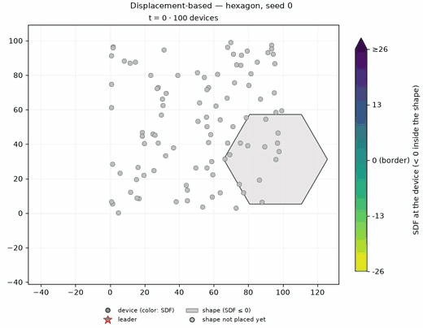
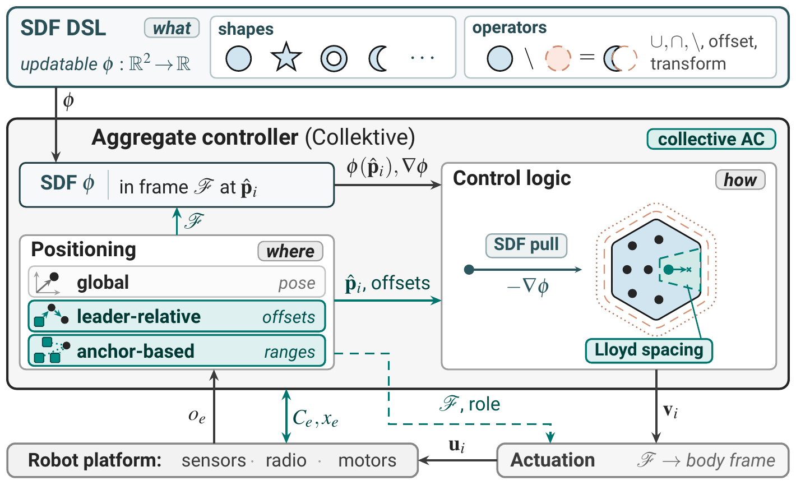
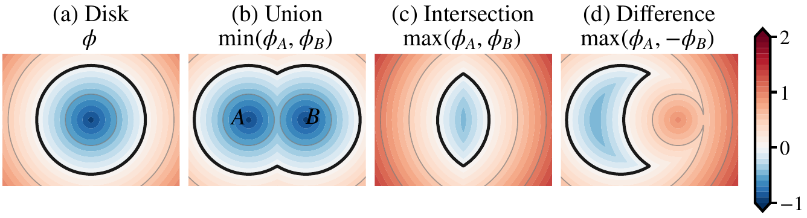
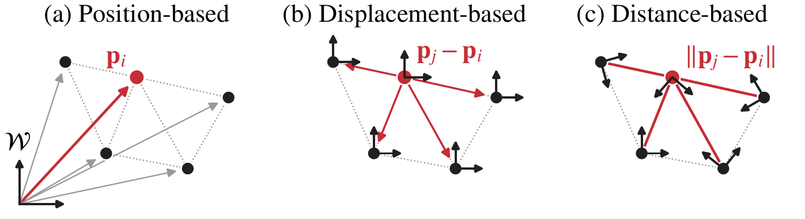
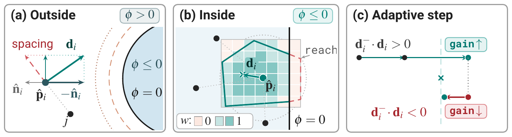
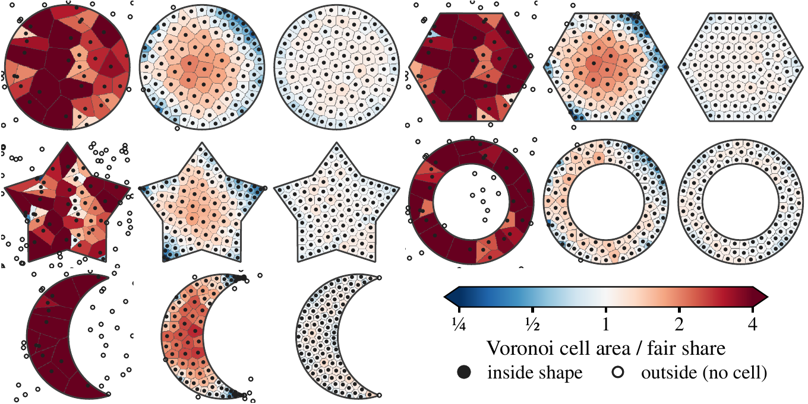
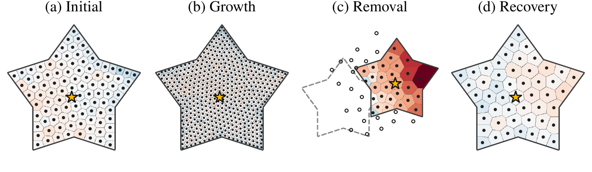
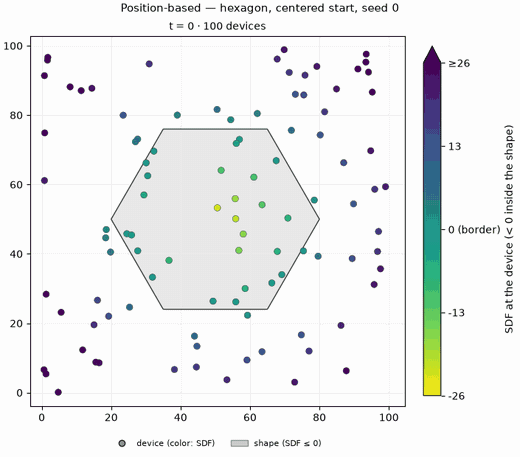
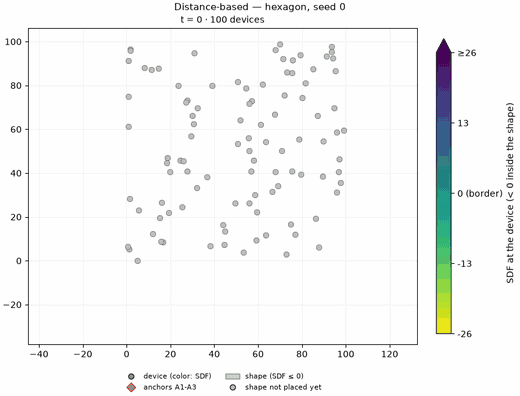

# A Macroprogramming Framework for Adaptive Swarm Formation via Signed Distance Functions

This artifact is associated with the regular paper article submitted in the Main Track of the SEAMS 2026 conference.

[Zenodo repository](TBD) - [[DOI]](TBD) > both currently anonimized for double-blind review.

### Authors

Anonimized for double-blind review.

### Table of Contents
- [About](#about)
    * [Experiments](#experiments)
- [Getting Started](#getting-started)
    - [Requirements](#requirements)
    - [Limitations](#limitations)
    - [Understanding the experiments](#understanding-the-experiments)
    - [Walk-through the experiments](#walk-through-the-experiments)
    - [Reproduce the entire experiment](#reproduce-the-entire-experiment)
        * [Simulation Graphical Interface](#simulation-graphical-interface)
        * [Extremely quick-start of a basic experiment -- `(ba|z|fi)?sh` users only](#extremely-quick-start-of-a-basic-experiment----bazfish-users-only)
        * [Reproduce the experiments through Gradle](#reproduce-the-experiments-through-gradle)
        * [Changing experiment's parameters](#changing-experiments-parameters)
        * [Project structure](#project-structure)
        * [Simulation entrypoint](#simulation-entrypoint)
    - [Reproduce the experiment results](#reproduce-the-experiment-results)
        * [Reproduce the experiments with containers (recommended)](#reproduce-the-experiments-with-containers-recommended)
        * [Reproduce natively](#reproduce-natively)
        * [Generate the charts](#generate-the-charts)

## About

Robot swarms are decentralized self-adaptive systems that must form, maintain, and re-form spatial formations
as tasks, environments, and their population change at runtime.
Engineering such formations involves three concerns:
*what* shape the swarm should take,
*where* each robot is with respect to that shape,
and *how* robots coordinate to realize it.
However, existing approaches typically bind a shape representation to a specific control law and positioning assumption,
so changing any of them requires redesigning the collective behavior.
In this paper, we propose a macroprogramming framework that treats formations as first-class, runtime-updatable specifications,
decoupled from their distributed realization.
We express formations as Signed Distance Functions (SDFs) composed through set-theoretic and blending operators,
which every robot evaluates locally, independently of swarm size and robot identities.
Positioning and control are aggregate programs:
the former computes the frame in which each robot evaluates the SDF (from global localization, a leader, or fixed anchors);
the latter drives robots into the shape and spreads them evenly through Lloyd-style coverage over neighbor positions.
Since each layer is a self-organizing field computation,
the swarm keeps adapting to robots joining or leaving and to topology changes without centralized coordination.
We formalize the framework, implement it in [Collektive](https://github.com/Collektive/collektive),
and evaluate it via simulation across formation and re-formation scenarios that vary shapes, positioning systems, and population size,
including runtime switches of both the target shape and the positioning strategy.



*Displacement-based positioning on the hexagon: the swarm forms the shape,
re-spreads after 400 robots join at `t = 1000 s`, and re-forms it after the removal at `t = 2000 s` leaves 50 survivors.*



*Overview of the framework, executed by every robot at every round:
the SDF DSL defines **what** shape to form, positioning defines **where** each robot is,
and the control logic defines **how** robots coordinate to form it.*

### Experiments

The repository contains **four** main experiment configurations, the ones evaluated in the paper.
All of them run the *same* formation specification and control logic.
The first three differ only in the positioning strategy (i.e., what each robot perceives of space):

- `dynamicPopulationPositionBased`: **position-based** (global) perception, every robot knows its absolute position;
  batch over the shape and the initial deployment (`start` in `[left, centered]`).
- `dynamicPopulationDisplacementBased`: **displacement-based** (aligned relative) perception,
  robots sense the relative displacement of their neighbors and localize with respect to an elected leader.
- `dynamicPopulationDistanceBased`: **distance-based** (range-only) perception,
  robots sense only the distances to their neighbors and trilaterate with respect to three elected anchors.

In these configurations the population changes at runtime:
the swarm starts with 100 robots, then 400 robots join it,
and later random robots are removed until only 50 survivors are left.
They assess whether the swarm forms the shape (**G1**), whether it does so under all three perception strategies (**G2**),
and whether it re-converges when robots join or leave (**G3**).

The fourth configuration assesses these requirements jointly (**G4**), changing both *what* and *where* while the swarm runs:

- `runtimePositioning`: **runtime shape and positioning switching**, with 100 robots for `1800` simulated seconds.
  Every `600 s` all robots switch positioning and actuation (displacement-based, then distance-based, then position-based),
  mimicking a mission where the localization infrastructure changes over time;
  within each positioning phase, the shape switches from a `circle` to a `star` after `300 s`.

The repository also contains three additional scenarios, `positionBased`, `displacementBased`, and `distanceBased`,
which use the same three positioning strategies but **never change the number of robots** (always 100).
They are not part of the quantitative evaluation:
they just give a quick idea of how the swarm behaves with the different shapes
(the same `circle`, `hexagon`, `star`, `ring`, and `crescent`),
and are handy to inspect the formation of a single shape in the graphical interface.

## Getting Started

### Requirements

In order to successfully download and execute the graphical experiments, you will need:

- Internet connection;
- [Git](https://git-scm.com);
- Linux, macOS, or Windows;
- [Java](https://adoptium.net/) 17 or newer;
- about 4GB of free disk space for Gradle dependencies and generated outputs;
- GPU with basic OpenGL support for the Alchemist graphical interface;
- at least 4GB of RAM for interactive runs, and preferably more for batch executions.

To reproduce the result-processing pipeline natively, you will also need:

- Python `3.14` recommended, matching `.python-version`;
- `pip` to install the dependencies listed in `requirements.txt`.

To use the container-based workflow, you will additionally need:

- [Docker](https://www.docker.com/);
- Docker Compose.

The project uses the [Gradle](https://gradle.org) wrapper included in the repository,
so a separate Gradle installation is not required.
The main JVM dependencies are declared in `gradle/libs.versions.toml`,
and the simulation tasks are generated automatically from the YAML files in `src/main/yaml`.

### Limitations

- The experiments run in "batch mode" generate a lot of data,
  and the simulation may take a long time to finish (up to several hours) even with high-performance computers.
  We suggest running the experiments in "graphic mode" to have a better understanding of the simulation;
- On different monitor types with different resolutions, the graphical interface could appear a bit different;
- "batch mode" does not show any graphical interface;
- For GUI interpretation, please refer to the [Simulation Graphical Interface](#simulation-graphical-interface) section;
- Due to Alchemist's limitations, the graphical interface will not appear if run on a docker container.

### Understanding the experiments

Each experiment combines the same building blocks, which mirror the three concerns of adaptive formation:

- **what** (formation specification): the target shape is an SDF $\phi$ built with the Kotlin DSL in
  `it.unibo.collektive.sdf` (closed-form primitives such as `Circle`, `Polygon`, `Segment`,
  combined through union, intersection, difference, offsets, and transformations).
  The shapes used by the experiments are declared by name in `src/main/resources/shapes.yml`
  and selected through the `shape` variable of each YAML file;
- **where** (positioning): an aggregate program builds the *formation frame* in which each robot evaluates $\phi$,
  returning its estimated position and the offsets of its neighbors (`it.unibo.collektive.localization.Positioning`):
  `global` (position read from a location sensor), `leaderRelative` (displacements accumulated from a leader elected with `boundedElection`),
  or `anchorBased` (three anchors elected across multiple hops, and trilateration from DV-distance estimates);
- **how** (control logic): `latticeVelocity` (`it.unibo.collektive.coverage`) pulls robots outside the shape towards it
  along $-\nabla\phi$, and spreads robots inside it towards the centroid of their local Voronoi cell clipped to the shape (Lloyd-style coverage),
  with an Rprop-inspired adaptive step to damp oscillations;
- **actuation**: the desired velocity is rotated into the robot's body frame and applied by the `SpeedToTarget` action.
  With range-only perception, each robot learns the rotation between its body frame and the formation frame from how its own commands move it.



*An exact disk SDF (a) and implicit fields composed from two overlapping disks A, B (b–d):
blue denotes negative values (inside), red positive ones (outside), black the zero contour (the shape boundary).*



*The three positioning strategies: each robot (red) senses (a) its absolute position in the global frame,
(b) displacements to its neighbors in aligned local frames, or (c) only distances to its neighbors, with arbitrarily oriented local frames.*



*Control logic: (a) boundary pull and filtered spacing outside the shape, (b) clipped Voronoi centroid inside, and (c) step-gain adaptation.*

When the frame is built collectively (displacement- and distance-based positioning),
the leader places the shape inside the swarm (at a point locally farthest from its boundary)
and disseminates it through the network, so that every robot evaluates the same shape in the same frame,
and a new leader re-places it if the previous one is removed.

All scenarios use an adaptive communication model (`AdaptiveRange`):
each robot adjusts its communication range to have about `12 ± 6` neighbors,
starting from `30` simulated meters and staying within `[1, 100]` simulated meters.

During the simulation, every `10` simulated seconds the `FormationMetrics` and `CoverageMetrics` extractors
compute, from the ground-truth positions (that robots never perceive),
how evenly the robots cover the placed shape:
Jain's fairness index over the Voronoi cell areas (`jain`), the fraction of robots inside the shape (`inside`),
the average normalized motion (`motion`), and further coverage statistics.
These metrics are written to `data/<experiment-name>/<experiment-name>_seed-<seed>_shape-<shape>[_start-<start>].csv`
(in `runtimePositioning`, the metrics are computed on the shape as placed by the positioning strategy active at that time).
Every `2` simulated seconds, `DevicePositionsExporter` also records the position, the role (leader, anchor, or plain node),
and the value of the SDF of each robot under `data/positions/<experiment-name>/`, which are used for snapshots and GIFs.

### Walk-through the experiments

This section provides a brief overview of the formation experiments currently available in the repository.
All three main scenarios start with `100` robots with unique identifiers,
deployed at random in a `100 x 100` simulated meters environment,
and batch over five shapes:

- `circle`: convex, without sharp corners;
- `hexagon`: convex, without sharp corners;
- `star`: non-convex, with sharper corners;
- `ring`: non-convex, with a hole in the middle (a circle with a smaller circle subtracted);
- `crescent`: non-convex, obtained by subtracting a circle from another, offset one.



*Voronoi coverage of the five shapes with position-based positioning (100 robots, centered start, seed 0)
at `t = 0 s`, `40 s`, and `990 s` (left to right for each shape).
Cell colors encode the cell area relative to the ideal equal share (blue below 1, gray near 1, red above 1),
hollow markers denote robots outside the shape: the initially uneven cell areas approach the equal share over time.*

Each simulation goes through three population phases:
at `t = 1000` simulated seconds, `400` new robots spawn near the swarm (within the communication range of existing robots,
so that a single connected swarm is kept), reaching `500` robots;
at `t = 2000` simulated seconds, random robots are removed until `50` survivors are left;
the simulation ends at `t = 3000` simulated seconds.



*Runtime adaptation on the star with displacement-based positioning (seed 0): (a) initial formation with 100 robots;
(b) adaptation after the population grows to 500; (c) redistribution and reference-frame change after removal leaves 50 survivors
(dashed outline: previous frame); (d) recovered formation. The star marks the elected leader,
and cell colors encode the Voronoi cell area relative to the ideal equal share (blue below, red above).*

The main scenarios are:
- _dynamicPopulationPositionBased_: every robot reads its global position,
  and the shape lies where `shapes.yml` places it.
  Since with a centered deployment most robots would already start inside the shape,
  the scenario also batches over `start`: `centered` (square of side `100` around the shape center)
  and `left` (all robots deployed to the left of the shape, none inside);
- _dynamicPopulationDisplacementBased_: robots perceive only the relative displacements of their neighbors in aligned frames.
  A leader is elected, every robot computes its position relative to it by accumulating displacements along the shortest path,
  and the shape is placed around the leader;
- _dynamicPopulationDistanceBased_: robots perceive only the distances to their neighbors, in arbitrarily oriented local frames.
  Three anchors are elected to define the frame from mutual distances,
  every robot trilaterates its position, and the shape is placed around the anchors.

<table>
  <tr>
    <th>Position-based</th>
    <th>Displacement-based</th>
    <th>Distance-based</th>
  </tr>
  <tr>
    <td></td>
    <td></td>
    <td></td>
  </tr>
</table>

*The same hexagon specification formed under the three positioning strategies (seed 0), through the join and removal events.*

The runtime-switching scenario is:
- _runtimePositioning_: `100` robots deployed at random in the same `100 x 100` environment, no robot joins or leaves,
  and the simulation ends at `t = 1800` simulated seconds. The positioning strategy, the shape placement, and the actuation
  change at runtime, while the control logic runs uninterrupted:
    - `0 ≤ t < 600`: displacement-based positioning, shape placed around the elected leader;
    - `600 ≤ t < 1200`: distance-based positioning, new anchors are elected and the shape is placed around them,
      robots learn the rotation of their body frame (unknown heading);
    - `1200 ≤ t ≤ 1800`: position-based positioning, the shape lies where `shapes.yml` places it in the global frame
      (so the swarm must cross the arena to reach it), and leader and anchor roles are dropped.

  Within each phase the shape is a `circle` for the first `300 s` and a `star` for the following `300 s`.
  Shape switches only change the SDF, so robots stay inside the new shape and just redistribute over it;
  positioning switches also change the formation frame, and therefore cause larger transients.

The detailed instructions to reproduce the experiment are in the section
"[Reproduce the entire experiment](#reproduce-the-entire-experiment)".

A graphical simulation can be launched from a Unix terminal with one of the following commands:

```bash
./gradlew runDynamicPopulationPositionBasedGraphic
./gradlew runDynamicPopulationDisplacementBasedGraphic
./gradlew runDynamicPopulationDistanceBasedGraphic
./gradlew runRuntimePositioningGraphic
```

The additional fixed-population scenarios have the same setup (100 robots deployed at random in the `100 x 100` environment,
same positioning strategies and control logic), but no robot joins or leaves:
they only show how the swarm forms each shape, and can be launched with:

```bash
./gradlew runPositionBasedGraphic
./gradlew runDisplacementBasedGraphic
./gradlew runDistanceBasedGraphic
```

or through the scripts in the section
"[Extremely quick-start](#extremely-quick-start-of-a-basic-experiment----bazfish-users-only)".
Note that `MAX_SEED` is relevant only for batch executions,
and it is therefore unnecessary for graphical runs.

Once the simulation has started, the Alchemist GUI will open.
After Alchemist finishes loading,
you will see the robots deployed in the environment,
colored according to their signed distance from the shape (`distanceToSDF`),
with the leader highlighted (`leader`).
Robots outside the shape move towards it, and those inside progressively spread until they cover it evenly.
In the dynamic scenarios, at the spawn event the new robots appear around the swarm, enter the shape, and the swarm re-spreads;
at the removal event, the survivors spread again over the whole shape.
In the displacement- and distance-based scenarios, if the leader (or an anchor) is removed,
a new one is elected and the formation frame, and with it the placed shape, may move accordingly.
In the distance-based scenarios, the heading of each robot and its actuation are drawn as well.
In the runtime-switching scenario, the swarm re-forms the shape at every switch: every `300 s` the circle becomes a star
(or vice versa), at `t = 600` the anchors are elected and the shape moves around them,
and at `t = 1200` the swarm travels to the global position of the shape.

The nodes may be initially hidden depending on the monitor resolution and the default zoom level of the GUI,
but they are present in the simulation.
It is usually sufficient to zoom out or move around the environment to see the whole setup.
To move around the environment, use the mouse to drag the view and the scroll wheel to zoom in and out.
To start, pause, and resume the simulation, press the <kbd>P</kbd> key.
If you want to execute it at "real time" speed,
press the <kbd>R</kbd> key, and press it again to return to the default speed.
For more GUI features, please refer to the
[Simulation Graphical Interface](#simulation-graphical-interface) section.

### Reproduce the entire experiment

**WARNING**: re-running the whole experiment to gather data may take a very long time on a normal computer.

#### Simulation Graphical Interface

The simulation environment and graphical interface are provided by
[Alchemist Simulator](https://alchemistsimulator.github.io/index.html).
To understand how to interact with the GUI,
please refer to the
[Alchemist Swing documentation](https://alchemistsimulator.github.io/reference/swing/index.html#shortcuts).

The JSON files under `effects/` define the visual overlays used by the supported graphic runs.
At the moment, effect files are available for:

- `dynamicPopulationPositionBased`
- `dynamicPopulationDisplacementBased`
- `dynamicPopulationDistanceBased`
- `runtimePositioning`
- `positionBased`
- `displacementBased`
- `distanceBased`

#### Extremely quick-start of a basic experiment -- `(ba|z|fi)?sh` users only

- Requires a Unix terminal (`(ba|z|fi)?sh`)
- `curl` and `unzip` must be installed
- run:
```bash
# Position-based experiment with default parameters and graphical interface
curl https://anonymous.4open.science/api/repo/experiments-2026-seams-ac-sdf/file/scripts/position-based.sh | sh
```
or
```bash
# Displacement-based experiment with default parameters and graphical interface
curl https://anonymous.4open.science/api/repo/experiments-2026-seams-ac-sdf/file/scripts/displacement-based.sh | sh
```
or
```bash
# Distance-based experiment with default parameters and graphical interface
curl https://anonymous.4open.science/api/repo/experiments-2026-seams-ac-sdf/file/scripts/distance-based.sh | sh
```
- the repository is in your `Downloads` folder for further inspection.

#### Reproduce the experiments through Gradle

1. Install a Gradle-compatible version of Java.
   Use the [Gradle/Java compatibility matrix](https://docs.gradle.org/current/userguide/compatibility.html) to learn which is the compatible version range.
   The Version of Gradle used in this experiment can be found in the gradle-wrapper.properties file located in the gradle/wrapper folder.
2. Open a terminal
3. Download this repository from the [anonymized link](https://anonymous.4open.science/r/experiments-2026-seams-ac-sdf/) and extract it on your pc.
4. Move into the root folder with `cd experiments-2026-seams-ac-sdf`
   (on Linux and macOS, run `chmod +x gradlew` if the wrapper is not executable after extraction)
5. Depending on the platform, run the following command:
    - Bash compatible (Linux, Mac OS X, Git Bash, Cygwin): ``` ./gradlew run<ExperimentName>Graphic ```
    - Windows native (cmd.exe, Powershell): ``` gradlew.bat run<ExperimentName>Graphic ```
6. Substitute `<ExperimentName>` with the name of the experiment (in PascalCase) specified in the YAML simulation file.
   Or execute ```./gradlew tasks``` to view the list of available tasks.

**NOTES:**
- Due to Alchemist's limitations, the graphical interface will not appear if run on a docker container.
- The tasks *in graphic mode* will run the experiments with the default parameters defined in the YAML.

**Note** that before each experiment command, it can be optionally set the `MAX_SEED` environment variable to a specific value to run the experiment,
since that parameter is relevant only for batch experiments,
it is suggested to **not** specify it or set it to `0` for the graphical experiments.

Depending on the platform, there may be different ways to set the environment variable:
- If you're using Bash compatible (Linux, Mac OS X, Git Bash, Cygwin): ```MAX_SEED=0 ./gradlew run<ExperimentName>Graphic```
- If you're using Command Prompt (cmd.exe): ```set MAX_SEED=0 && gradlew.bat run<ExperimentName>Graphic```
- If you're using PowerShell: ```$env:MAX_SEED = 0; .\gradlew.bat run<ExperimentName>Graphic``` \
  For the sake of simplicity, we will show Bash compatible commands below.
  Moreover, due to Alchemist's limitations, the graphical interface will not appear if run on a docker container.

The corresponding YAML simulation files to the experiments cited above are the following,
- _dynamicPopulationPositionBased_
- _dynamicPopulationDisplacementBased_
- _dynamicPopulationDistanceBased_
- _runtimePositioning_

and, for the additional fixed-population scenarios,
- _positionBased_
- _displacementBased_
- _distanceBased_

**Notes:**
- due to Alchemist limitations, the graphical interface is intended for local/native execution rather than containerized runs.

#### Changing experiment's parameters

To change the parameters of the experiments, edit the YAML files in `src/main/yaml/`.

The parameters you will most likely tune are:

- `shape`: the shape to form, by name from `src/main/resources/shapes.yml`
  (graphic runs use the first value, batch runs sweep over the list);
- `nodes`: the initial number of robots;
- `communicationRange`: the initial communication range (the `AdaptiveRange` network model then adapts it to have `12 ± 6` neighbors);
- `spawnTime`, `spawnCount`, `killTime`, and `survivors`: when and how the population changes (dynamic scenarios only).

In `runtimePositioning`, the switching times (`300 s` for the shape, `600` and `1200 s` for the positioning)
and the two alternating shapes (`circle` and `star`) are defined in `runtimePositioningEntrypoint`
(see [Simulation entrypoint](#simulation-entrypoint)), while the duration of the run is set by the `terminate` block of the YAML.

New shapes can be added to `src/main/resources/shapes.yml`
by giving the SDF `type` (e.g., `Star`, `Ring`, `TextBlock`) and its constructor parameters by name;
see the README of the `it.unibo.collektive.sdf` package for the available primitives, shapes, and operators.

Each change in the parameters will result in a different setup and execution of the experiment.
The parameters provided in the YAML files are the ones used for the evaluation.

For more information about the simulation DSL,
please refer to the
[Alchemist YAML documentation](https://alchemistsimulator.github.io/reference/yaml/index.html).

#### Project structure

The project is currently organized as follows:

```text
experiments-2026-seams-ac-sdf/
├── .github/workflows/          # CI: build-and-deploy and dispatcher workflows
├── data/                       # Simulation exports, used to generate the charts
├── docker/                     # Dockerfiles to build the containers (simulations and charts)
├── effects/                    # JSON specification for Alchemist's GUI visualization
├── gradle/                     # Gradle wrapper files
├── images/                     # Figures from the paper and GIFs of the simulations, used in this README
├── python/                     # Plotters (metrics, snapshots, GIFs) and their shared modules, launched by process.py
├── scripts/                    # Quick-start scripts (clone the repository and run a graphic simulation)
├── src/
│   └── main/
│       ├── kotlin/it/unibo/    # Kotlin source code for the experiments
│       │   ├── alchemist/      # Alchemist extensions
│       │   │   ├── boundary/   # GUI effects (effects), position exporter (exporters), and coverage/formation metrics (extractors)
│       │   │   └── model/      # Movement actions, deployments (ShapeStart), move strategies, and reactions (spawn and kill nodes)
│       │   └── collektive/
│       │       ├── actuation/         # Actuation: from the formation frame to the body frame (aligned or self-aligned)
│       │       ├── alchemist/device/  # Collektive integration for Alchemist: body frame, parameters, and sensors
│       │       │   └── sensors/       # Location, relative position, and shape definition (ShapeProperty)
│       │       ├── catalog/           # ShapeCatalog: builds the shapes defined in shapes.yml, by name
│       │       ├── coverage/          # Control logic: Lloyd on the Voronoi cell, local border of the shape, and adaptive step
│       │       ├── entrypoint/        # Entrypoints for the experiments (position, displacement, and distance based)
│       │       ├── geometry/          # Positions and vectors in the plane, with their operations
│       │       ├── library/           # Aggregate building blocks shared by the entrypoints (e.g., the shape spread by the leader)
│       │       ├── localization/      # Positioning: global, leader-relative, anchor election, trilateration, and frame alignment
│       │       └── sdf/               # DSL for 2D Signed Distance Fields: primitives, shapes, and text (see its README)
│       ├── resources/
│       │   └── shapes.yml      # The shapes the experiments batch over: SDF type and constructor parameters, by name
│       └── yaml/               # YAML files for the experiments specification
├── build.gradle.kts            # Gradle build, generates the simulation tasks from the YAML files
├── docker-compose.yml          # Runs the simulations and the charts in containers
├── process.py                  # Runs all the plotters (or some: python process.py --help)
└── run-batches.sh              # Runs the three dynamic-population batches in parallel
```

#### Simulation entrypoint

The aggregate entrypoints for the experiments are located in the `it.unibo.collektive.entrypoint` package,
in `Entrypoint.kt`.
Each YAML file declares the function called by Alchemist through `RunCollektiveProgram`.
That function is executed periodically by every node and is responsible for reading the local sensors and simulation molecules,
running the Collektive aggregate computation,
and storing the output molecules, such as the desired velocity (later applied by the `SpeedToTarget` action),
`distanceToSDF`, and `leader`.

All the entrypoints delegate to the same modular function, `swarmFormation`,
which takes the three concerns as pluggable parameters:

```kotlin
fun Aggregate<Int>.swarmFormation(
    positioning: Positioning,          // where: builds the formation frame
    translateShape: ShapeTranslation,  // what: places the SDF in that frame
    control: FormationControl = FormationControl.lattice(), // how: desired velocity
    actuate: Actuation = Actuation.aligned,                 // from the frame to the body frame
)
```

The entrypoints used by the current scenarios are:
- _positionBased_ and _dynamicPopulationPositionBased_:
  `it.unibo.collektive.entrypoint.EntrypointKt.positionBasedEntrypoint`.
  It uses `Positioning.global` (each robot reads its coordinates from its `LocationSensor`),
  `ShapeTranslation.global` (the shape lies where `shapes.yml` places it),
  and `Actuation.aligned`;
- _displacementBased_ and _dynamicPopulationDisplacementBased_:
  `it.unibo.collektive.entrypoint.EntrypointKt.displacementBasedEntrypoint`.
  It uses `Positioning.leaderRelative` (a leader is elected with `boundedElection`,
  and each robot accumulates the sensed displacements along the shortest path from it with `gradientCast`),
  `ShapeTranslation.fromLeader` (the leader places the shape around itself and spreads it with `hopGradientCast`),
  and `Actuation.aligned` (the leader, as reference, stays still);
- _distanceBased_ and _dynamicPopulationDistanceBased_:
  `it.unibo.collektive.entrypoint.EntrypointKt.distanceBasedEntrypoint`.
  It uses `Positioning.anchorBased` (three anchors are elected across multiple hops,
  and each robot trilaterates its position from DV-distance estimates),
  `ShapeTranslation.fromLeader`,
  and `Actuation.selfAligned` (each robot learns the rotation of its body frame from how its own commands move it);
- _runtimePositioning_:
  `it.unibo.collektive.entrypoint.EntrypointKt.runtimePositioningEntrypoint`.
  At every round, it reads the simulated time and picks the components of `swarmFormation` for the current phase:
  `leaderRelative` + `fromLeader` + `aligned` up to `t = 600`,
  `anchorBased` + `fromLeader` + `selfAligned` (with the unknown body frame active) up to `t = 1200`,
  and `global` + `global` + `aligned` afterwards;
  it also writes the current shape (`circle` or `star`, alternating every `300 s`) in the `shape` molecule,
  read by the leader that spreads it, and the current placement in the `placement` molecule,
  read by the exporters (`placement: runtime`).
  Since the three concerns are pluggable parameters, switching them at runtime requires no change to `swarmFormation`.

The control logic is implemented by `latticeVelocity` in the `it.unibo.collektive.coverage` package:
when a robot is outside the shape ($\phi > 0$) it follows the inward pull $-\nabla\phi$ (estimated by finite differences),
plus the tangential component of its Voronoi vector;
when it is inside ($\phi \le 0$) it moves towards the centroid of its local Voronoi cell,
built only from the neighbor offsets and clipped to the shape.
`AdaptiveStep` modulates the speed, shrinking the gain when the direction reverses (overshoot)
and growing it back while it stays consistent.
Since the Voronoi cell is recomputed at every round from the current neighbors,
the swarm automatically re-spreads whenever robots join or leave.

The dynamic scenarios also run two Alchemist global reactions:
`SpawnNearNodes` adds `spawnCount` robots at `spawnTime`, near the existing ones,
and `KillRandomNodes` removes random robots at `killTime` until `survivors` are left.

### Reproduce the experiment results

**WARNING**: re-running the whole experiment may take a very long time on a normal computer.

For the current project status, result reproduction means:

- running the batch simulations so that the metrics and the positions are exported as CSV files under `data/`;
- post-processing those CSV files with the Python scripts under `python/` (launched by `process.py`);
- optionally adapting the plotting scripts to the exact set of experiments you want to compare.

The results in the paper use `32` seeds (`MAX_SEED=31`) for each configuration:
4 dynamic-population scenarios (position-based with two starts, displacement-, and distance-based) × 5 shapes × 32 seeds
give 640 dynamic-population runs, plus 32 runtime-switching runs (672 in total).

#### Reproduce the experiments with containers (recommended)

1. Install [Docker](https://www.docker.com/products/docker-desktop) and [docker-compose](https://docs.docker.com/compose/install/);
2. Run `docker-compose up` in the root folder of the repository:
   this will build the Docker images and run the containers needed to run the experiments.
   The number of seeds can be set with `MAX_SEED`, e.g., `MAX_SEED=31 docker-compose up`.
3. From the `docker-compose.yml` file, you can see that seven services are defined:
   `prepare` (creates the `data` and `charts` folders),
   one simulation service for each main experiment (`dynamicPopulationPositionBased`, `dynamicPopulationDisplacementBased`, `dynamicPopulationDistanceBased`, `runtimePositioning`),
   `charts` (generates the charts once the simulations are over),
   and `finish` (fixes the permissions of the generated files).
   The data will be collected in the `data` folder, and the charts in the `charts` folder.
   Note that the `volumes` field has to be updated to match your local environment.
   You may need to adjust the `volumes` paths to match your machine.

#### Reproduce natively

1. Install a Gradle-compatible version of Java.
   Use the [Gradle/Java compatibility matrix](https://docs.gradle.org/current/userguide/compatibility.html)
   to learn which is the compatible version range.
   The Version of Gradle used in this experiment can be found in the `gradle-wrapper.properties` file
   located in the `gradle/wrapper` folder.
2. Install the version of Python indicated in `.python-version` (or use `pyenv`).
3. Launch the batches of the four main experiments, the only ones evaluated in the paper:
    - `./run-batches.sh 31` on Linux, MacOS, or Windows if a bash-compatible shell is available,
      which runs the three dynamic-population ones in parallel with seeds `0..31` (without the argument, the default seeds `0..5` are used),
      followed by `MAX_SEED=31 ./gradlew runRuntimePositioningBatch` for the runtime-switching one;
    - or each one separately, e.g., `MAX_SEED=31 ./gradlew runDynamicPopulationPositionBasedBatch`
      (and `runDynamicPopulationDisplacementBasedBatch`, `runDynamicPopulationDistanceBasedBatch`, `runRuntimePositioningBatch`);
    - on Windows cmd or Powershell, `gradlew.bat run<ExperimentName>Batch` for each of them, after setting `MAX_SEED`
      as shown in "[Reproduce the experiments through Gradle](#reproduce-the-experiments-through-gradle)".

   Note that `./gradlew runAllBatch` would also run in batch the fixed-population scenarios,
   which are meant only for the graphical interface and are not part of the evaluation.
4. Once the experiment is finished, the results will be available in the `data` folder,
   **if data extraction is properly configured in the YAML files**.

#### Generate the charts

**WARNING**: depending on the amount of data collected, this process may take a long time.

1. Make sure you have the Python version indicated in `.python-version` (3.14) installed.
2. The data folder structure should be the following:
    ```txt
    experiments-2026-seams-ac-sdf/
    ├── data/
    │   ├── <experiment-name>/
    │   ├── <experiment-name2>/
    │   ├── .../
    │   └── positions/
    │       ├── <experiment-name>/
    │       └── .../
    ```
3. Install the required Python packages by running:
    ```bash
    python3 -m venv env
    source env/bin/activate
    pip install --upgrade pip
    pip install -r requirements.txt
    ```
4. Run the script to process the data and generate the charts (this process may take some time):
    ```bash
    python process.py                 # all the plotters
    python process.py metrics         # or some of them: metrics, snapshots, gifs, fairness, runtime (M, S, G, F, R)
    python process.py --help          # filters (e.g. --where shape=star) and the other options
    ```
5. The charts will be generated in the `charts` folder
   (`charts/dynamic/` for the metrics over time of the dynamic-population experiments,
   `charts/runtime/` for those of the runtime-switching experiment,
   and `charts/positions/` for snapshots, GIFs, and fairness maps).
   See `python/README.md` for more details on each plotter.
6. If you want to regenerate the charts, you can run the script again.
